# Veyra — The Lantern Isles

A six-page website with an original explorable 3D world, **51 characters: 31 original residents and 20 anime guests**, real user accounts and private favourites. Built in the `dewebsite-` repository for your own deployment and DevOps practice. No hosting, Docker, infrastructure, or CI/CD configuration is included.

## Meet Aela Venn

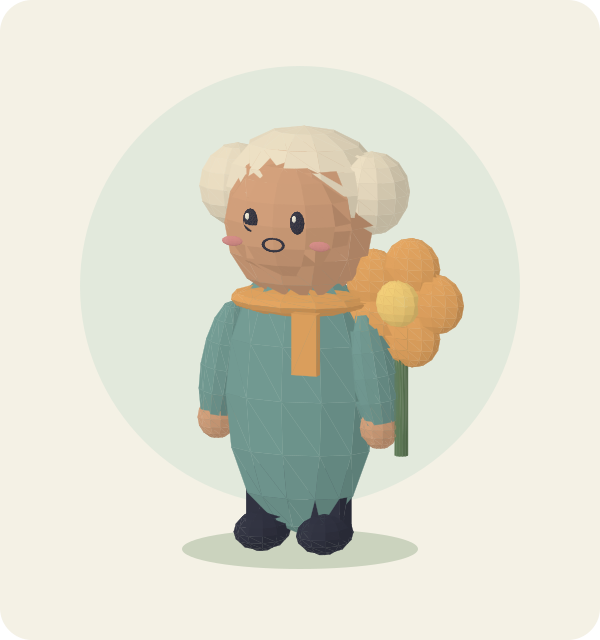

**Cloud gardener · Sunmere** — Gentle, adventurous and encouraging.

Aela catches stray clouds in woven baskets and waters the harbour gardens with their rain. When a dry summer dimmed the lantern flowers, she followed a wandering cloud home and returned with seeds that bloom in mist.

**Her dream:** Grow a floating garden where every traveller can rest.

This portrait is a static vector rendering of Aela's actual Three.js character model. Find her in the catalogue at `/characters/aela-venn`, or meet her in Sunmere. Regenerate the portrait with `node scripts/render-character.mjs` after building the character data.

## Naruto and One Piece — 20 new 3D models

Open **Characters**, choose **Naruto** or **One Piece**, then select a character. Drag to rotate freely, scroll/pinch to zoom, or use **Front / Back / Left / Right / Top / Bottom**. Pause or enable auto rotation. The profile viewer has no ground plane hiding the underside. Use **Expand viewer** for a full-viewport view; **Close full screen** or Escape returns to the page. **Reset camera** restores the front view, and **Background** offers Studio, Light and Dark.

These are **stylised, unofficial fan models** with articulated mesh groups, not detailed replicas or imported game rigs. Each has a distinct costume and geometry: Naruto's whiskers and headband, Gaara's rear gourd, Zoro's three swords, Usopp's long nose, Chopper's antlers, Franky's mechanical arms, Brook's skeleton and Jinbe's wide fish-man form.

### Poses, animation and lead-character detail

- All 20 anime guests have an individual **Signature pose** and a **Neutral stance** option. Their articulated head/arm/leg groups use the same meshes in the world and profile viewer.
- **Animation** offers Breathe & blink, Walk in place, and Still. Brook has eye sockets and does not blink. Walking is a procedural preview loop; it does not move the character across the world or provide gameplay.
- Animation and camera rotation have separate controls. Reduced-motion preferences start the viewer with animation and rotation off; select a mode to enable them.
- Naruto has smoother facial geometry, blue irises, extra hair detail, jacket panels and seams, a leaf-style headband detail, shin wraps, sandals and a waist pouch.
- Luffy has smoother facial geometry, expressive eyes and grin, an open red vest, straw-hat weave and rim detail, hair tufts and sandals.
- These refinements focus on Naruto and Luffy first. The remaining 18 keep their existing stylised designs with the new poses and animation.

The images below are **static renders of those 3D meshes**. GitHub README displays the images; full interactive rotation is available in the running website. Naruto and One Piece characters/designs belong to their respective rights holders; this project is unaffiliated. The original Veyra cast is listed separately in the collection filter.

| Naruto | One Piece |
| --- | --- |
| **Naruto Uzumaki**<br>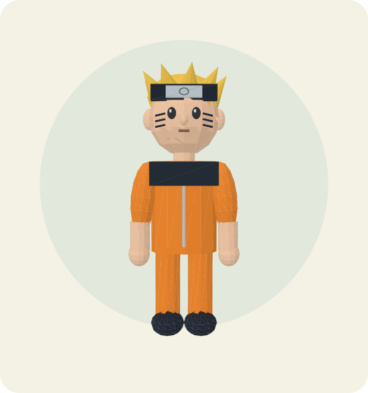 | **Monkey D. Luffy**<br>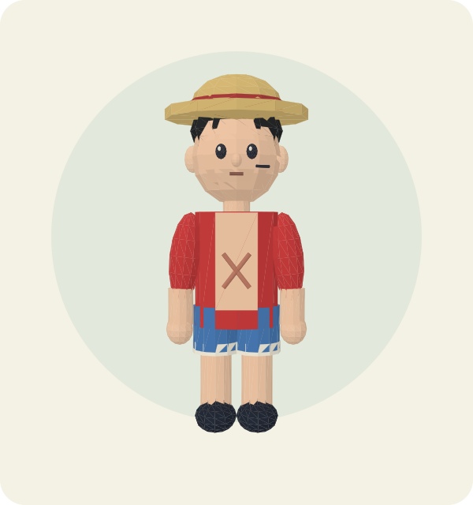 |
| **Sasuke Uchiha**<br>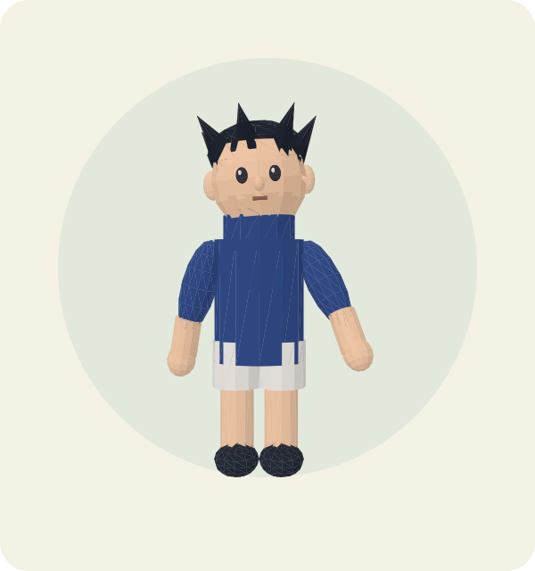 | **Roronoa Zoro**<br>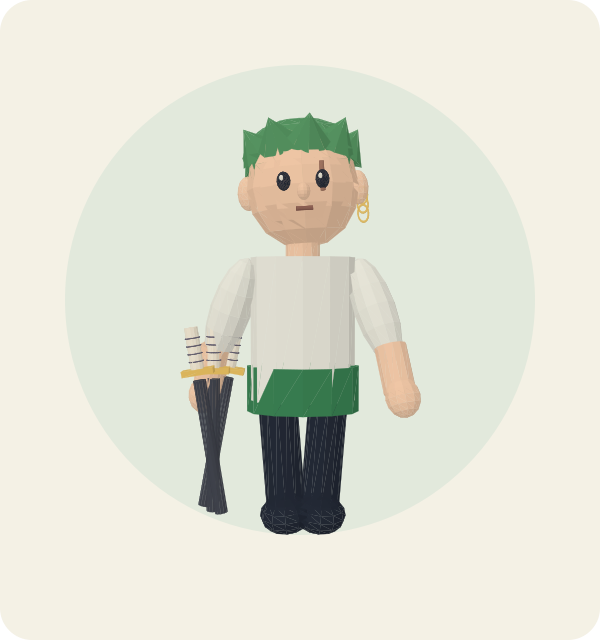 |
| **Sakura Haruno**<br>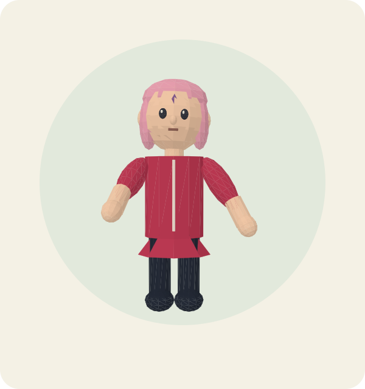 | **Nami**<br>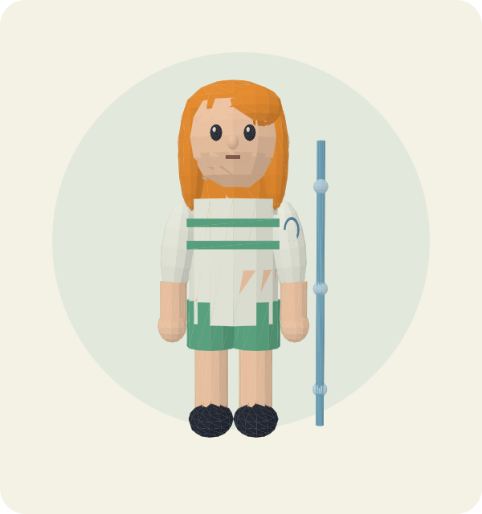 |
| **Kakashi Hatake**<br>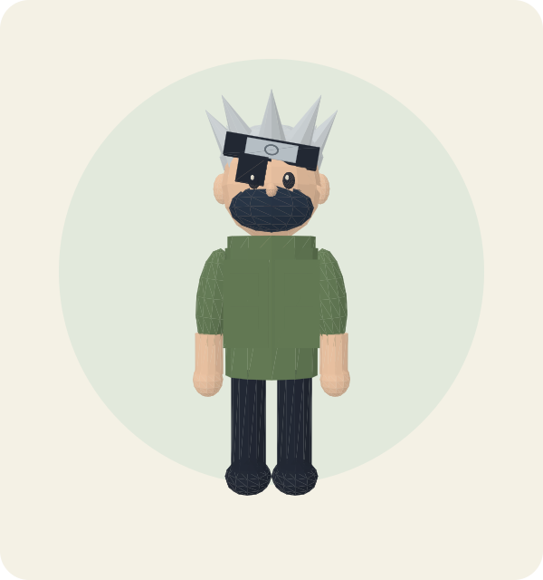 | **Usopp**<br>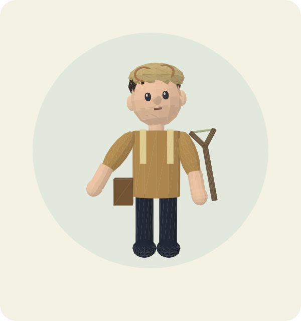 |
| **Hinata Hyuga**<br>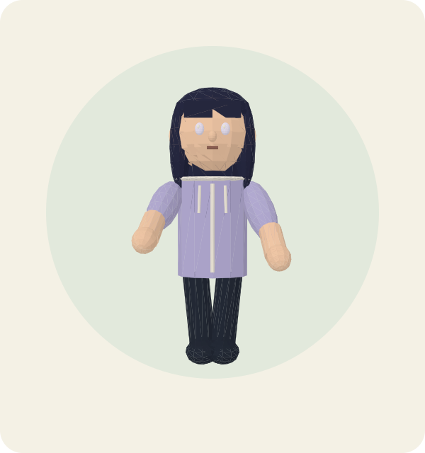 | **Sanji**<br>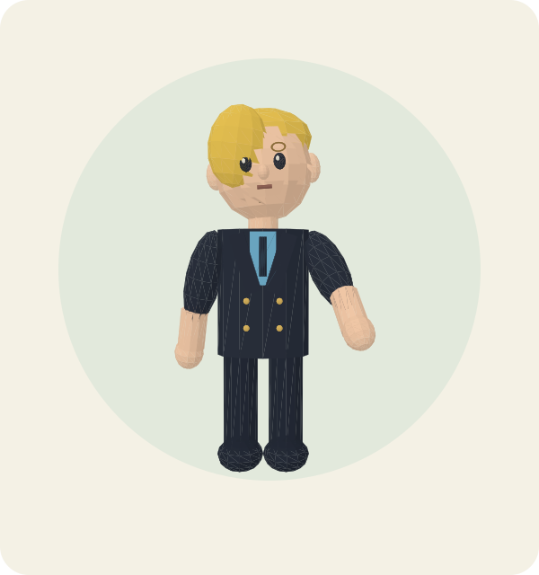 |
| **Itachi Uchiha**<br>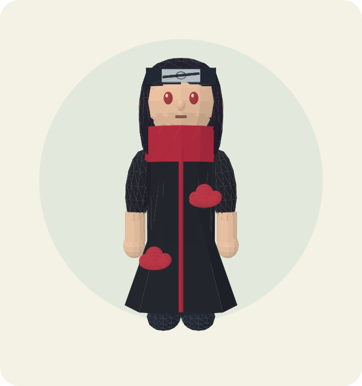 | **Tony Tony Chopper**<br>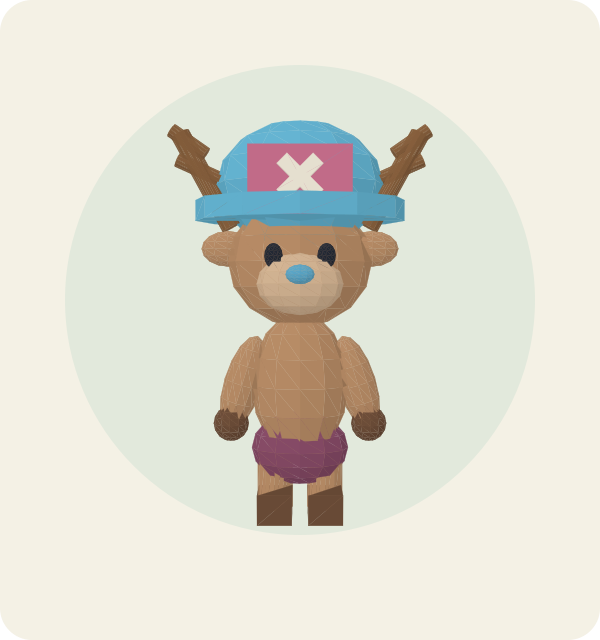 |
| **Gaara**<br>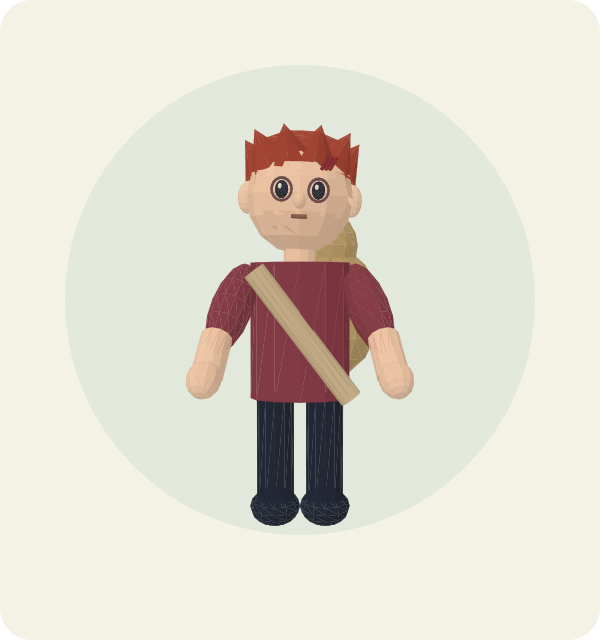 | **Nico Robin**<br>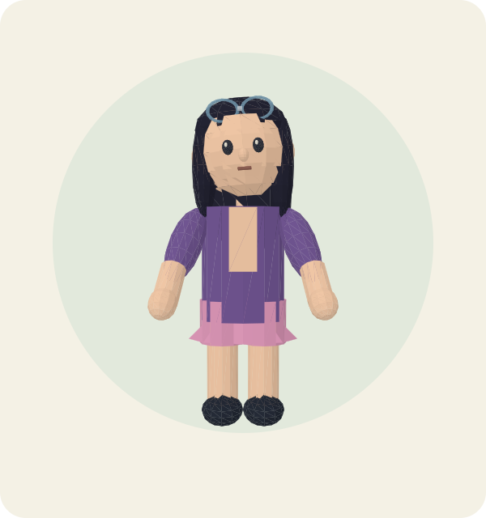 |
| **Shikamaru Nara**<br>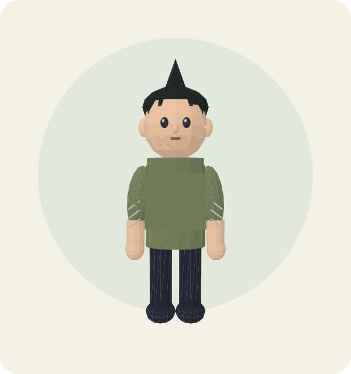 | **Franky**<br>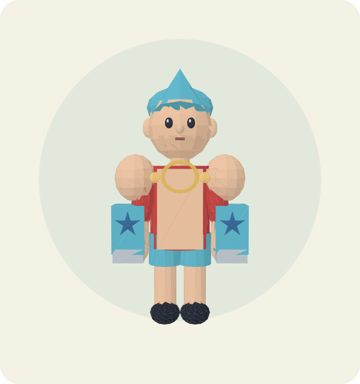 |
| **Rock Lee**<br>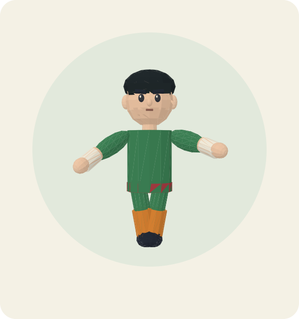 | **Brook**<br>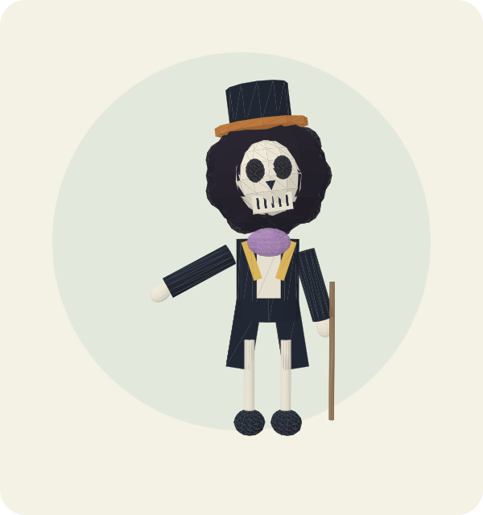 |
| **Jiraiya**<br>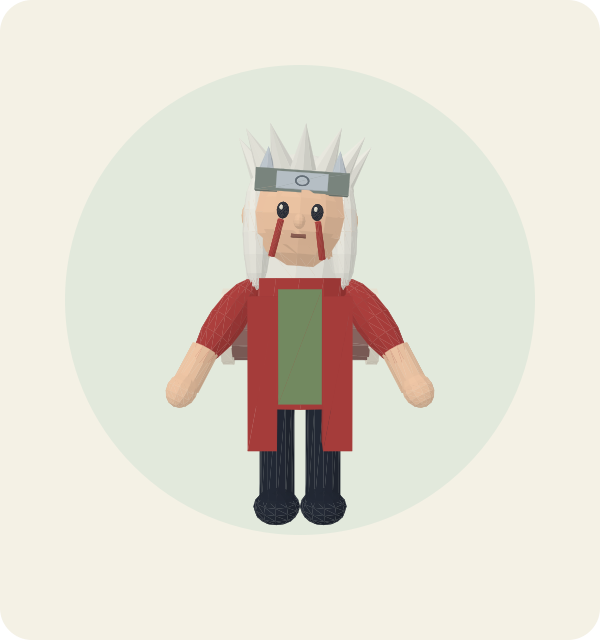 | **Jinbe**<br>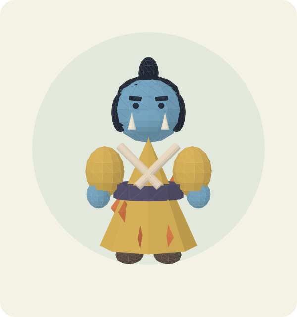 |

Rebuild the guest data and previews after changing their designs:

```bash
python3 scripts/create_world.py
node scripts/render-character.mjs --anime
npm run build
```

## What is in the website

| Page | Features |
| --- | --- |
| Explore `/` | Three connected floating islands, skybridges, buildings, landmarks, 51 characters, walking, orbit/zoom, region travel and a guided tour |
| Characters `/characters` | All 51 profiles, 3D model previews for anime guests, collection/island filters, search and favourite buttons |
| Character `/characters/ari-solwen` | Rotatable 3D model, individual story, personality, role, ambition and a link to their world location |
| Chronicle `/history` | Three region histories and six eras of original world lore |
| Favourites `/favourites` | A private, persistent collection for the signed-in account |
| Account `/account` | Registration, sign-in, account summary and sign-out |

**Sunmere** is a warm lantern harbour, **Glasswood** a forest that remembers lost paths, and **Cinderpeak** a crystal-and-forge settlement. The original cast has eleven residents in Sunmere and ten each in Glasswood and Cinderpeak. Twenty additional Naruto and One Piece fan characters visit the isles on a separate inner ring. The original cast and world lore remain unchanged. All meshes are built in code; no downloaded anime models, footage, textures or voices are bundled.

The models use simple, stylised 3D shapes with distinct hair, clothing colours and accessories. This is a compact navigable browser world, **not a detailed anime game or an unlimited open world**; animation uses lightweight articulated groups rather than imported skeletal rigs. Original-character cards use SVG illustrations; anime cards use static snapshots of their actual meshes. Profile and world views render real Three.js geometry.

## Run locally

Requirements: **Python 3.11+**, **Node.js 20+** and npm. Rendering happens in the visitor's browser using **WebGL 2**; EC2 does not need a rendering GPU. A browser without WebGL 2 gets an explanation and can still use the catalogue, stories and accounts.

```bash
git clone https://github.com/Vishnu063/dewebsite-.git
cd dewebsite-
python3 -m venv .venv
source .venv/bin/activate
python -m pip install -r requirements.txt
npm ci
npm run build
python app.py
```

Open **http://127.0.0.1:8000**. On Windows, activate with `.venv\Scripts\activate` instead of `source`. Ubuntu may require its `python3-venv` package before creating the environment. The Flask entry point binds to loopback by default; `--host` and `--port` are available for your own environment.

If running this on EC2 and viewing it from your computer, keep the app running and use your existing SSH connection for a tunnel:

```bash
ssh -i /path/to/your-key.pem -N -L 8000:127.0.0.1:8000 ubuntu@YOUR_EC2_PUBLIC_IP
```

Open the same local URL on your computer. Replace the key path and IP. This is a local viewing option, not a deployment setup.

The frontend build is generated into ignored `static/dist/`. Rebuild it with `npm run build` after editing frontend JavaScript. No CDN, external image service, account service or paid API is required at website runtime. The health endpoint is `/health`.

## Explore the world

- **Drag** to orbit the camera; scroll or pinch to zoom. **Full world** returns to the overview.
- Click a resident to see their name, role and profile link.
- **Walk the isles** enables the visitor avatar. Use **WASD / arrow keys** on a computer, or hold the onscreen direction buttons on touch devices. Drag to turn the camera. Skybridges connect every island; walking is bounded to islands/bridges and avoids buildings and central landmarks.
- Region travel buttons move to a new island. **Take a tour** visits residents automatically; pause it or select a resident to stop.
- Idle motion respects the browser's reduced-motion preference and can be paused. Rendering is capped at 30 frames per second with a limited pixel ratio.
- Use **Find in the world** from a character profile to locate that resident.

Create your own username and password on Account. There is **no default account or password**. The heart on any card or profile saves that resident to your personal collection. Accounts and favourites remain after the server restarts.

## Accounts and data

The backend uses SQLite in ignored `instance/veyra.sqlite3`. It stores scrypt password hashes, opaque session-token hashes, expiring server-side sessions and per-user favourites. Session cookies are HttpOnly and SameSite=Lax; authentication rotates sessions, and sign-out revokes the current token. Mutations require a session-bound CSRF token and reject cross-origin requests. Login/account attempt limits are enforced in the database. SQL statements use parameters.

Keep `instance/` private and retain it if you want accounts to survive moving/replacing the application. Do not commit databases, credentials or private keys. `APP_COOKIE_SECURE=1` enables Secure cookies when **you** run the app over HTTPS. The included Flask server is for local use; you handle production serving and deployment. Do not enter a real password over an unencrypted public connection.

Password reset, email verification, user deletion, moderation, administrative tools and a production security audit are **not included**. There is no multiplayer, combat, saved avatar position, dialogue system, sound track, character voice or downloadable rigged-model library.

## Edit the original world

The canonical authored content is `scripts/create_world.py`. It writes the committed `data/world.json` used by the API:

```bash
python scripts/create_world.py
```

`frontend/models.js` creates the character meshes and props; `frontend/world.js` creates the environment and controls. `frontend/layout.js` contains the shared walking and bridge calculations. The backend entry point is `app.py`, the app pages are in `frontend/app.js`, and styling is in `static/style.css`.

## Validation

```bash
python -m unittest discover -s tests -v
npm test
npm run build
```

**Current viewer/animation update:** the frontend was compiled and model-preview assets regenerated. Tests and live desktop/mobile checks have not been run for this update. The included checks below were run on the preceding version; they must be rerun to validate the new model and animation changes.

Existing test coverage:

- Nine backend tests (including all 20 guest routes, preview assets and favourites): real registration/login/logout, password hashing and session rotation, wrong passwords, expired sessions, duplicate names, attempt limits, CSRF/origin rejection, persistent private favourites across separate users and app restarts, six page routes, malformed/oversized input and the 51-character catalogue.
- Scene/control tests also cover the exact 20-guest roster, distinct mesh geometry, six camera angles, portrait assets and collision-free guest placement. Baseline checks: all 51 models have finite geometry and distinct design definitions; world construction places every resident; island/bridge connectivity, void boundaries and building collisions pass; guided tour start/pause works. Scene complexity remains bounded by the automated mesh/triangle budget. Browser/WebGL appearance and touch interaction have not been tested in this environment; the README previews are rendered offline from the actual geometry.
- The updated production frontend bundle compiles to approximately 564 KiB before compression.

**Verification limit:** this environment has no supported browser-control capability for visual/WebGL QA. Previous scene checks used real Three.js objects. This animation update has not been validated in a browser. Desktop/mobile camera composition, touch interaction and actual graphics performance need a browser trial. No EC2 deployment, public account security audit or 8 GB client-memory benchmark is claimed.

## Credits and licence

Application code and original Veyra content: MIT, see [LICENSE](LICENSE). Three.js is MIT; Flask and Werkzeug use BSD licences. npm and Python packages retain their own licences. This repository does not claim ownership of those dependencies.
