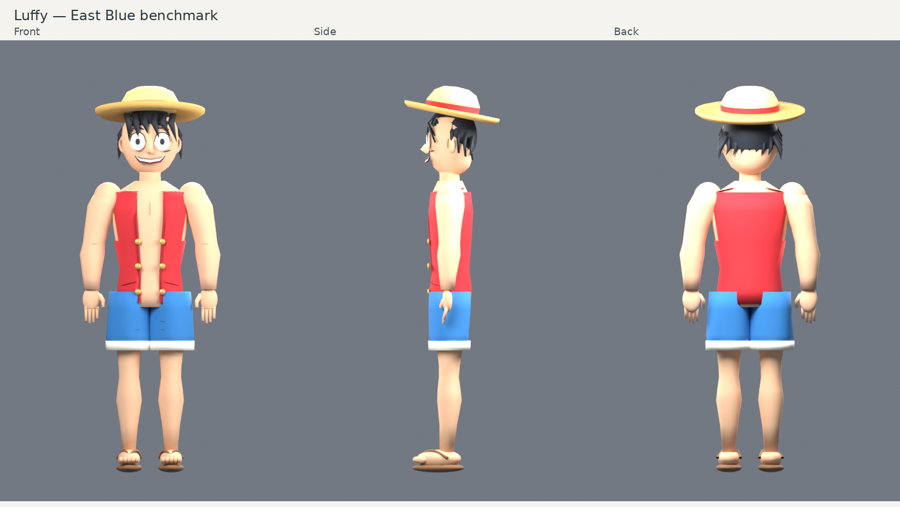

# Naruto and Luffy: first artwork benchmark

This branch is the first review batch, **2 of 20 characters**. It is not a claim that all characters have been upgraded or that likeness is approved. The remaining 18 keep their existing models until this standard is reviewed. The original 31 Veyra character definitions are unchanged.

## Actual mesh renders

The following neutral-stance frames were rendered in Blender from the geometry exported as the GLB assets. They are not generated concept illustrations. Browser lighting will differ from this studio lighting; animation and WebGL behaviour have not been tested.




## Versions and reference provenance

- **Naruto:** standard Naruto: Shippuden black-and-orange jacket, blue eyes, Leaf forehead protector, right-thigh bandage/holster, waist pouch and open-toed shinobi footwear. No Sage Mode coat, adult Hokage costume or battle damage. Main colour/proportion references: [manufacturer gallery](https://tamashiiweb.com/item/13853/?wovn=en), [official Naruto figure article](https://naruto-official.com/en/news/01_2641), [multi-angle figure gallery](https://tamashiiweb.com/item/14721/?wovn=en). A [turnaround-sheet mirror](https://yande.re/post/show/1029596) was located for angle reference; its attribution is not independently authenticated here.
- **Luffy:** classic East Blue sleeveless red vest, blue shorts with rolled hems, straw hat, sandals and cheek scar. No later chest scar, yellow sash or long-sleeved post-timeskip shirt. Main references: [official East Blue figure gallery](https://tamashiiweb.com/item/14796/?wovn=en), [Toei turnaround page](https://www.toei-anim.co.jp/tv/onep/news/nami_sp/ruffi/index.html), [season-one production-art collection](https://characterdesignreferences.com/art-of-animation-10/art-of-one-piece-season-1). Manufacturer photographs were inspected. Direct downloads of some Toei/turnaround images were blocked, so their details are not represented as independently verified from the full-resolution originals.

The reference images are linked, not redistributed or used as textures. All committed geometry and material definitions are authored by this project's Blender script. No third-party mesh, game rip or downloaded texture was imported. Naruto and One Piece character identities/designs remain with their respective rights holders; this is unaffiliated fan work. MIT covers the implementation, not ownership of those characters.

## What changed in geometry

The new assets replace the two generic bodies with fitted torso and limb lofts, shaped jaw/skull meshes, nose bridges, fitted eye surfaces, curved hair locks, clothing panels, hands with individual fingers, feet/toes and mounted accessories. Naruto has a curved forehead plate and back spiral; Luffy has a double-surface hat brim, crown weave and an open sleeveless vest. Meshes are grouped by joint and material to reduce object count.

The exported joint hierarchy includes shoulders, elbows, wrists, hips, knees, ankles and a head joint. The browser clones skinned instances with Three.js SkeletonUtils so their bone references remain independent. Hat, clothes, pouch and face details are parented to the appropriate joint. The frontend adapts these joints to the existing pose, blink, breathing and walk controls. **Naruto’s trouser legs and Luffy’s arms and bare legs use continuous weighted meshes across the knee/elbow regions.** The export adds glTF skin weights against the existing joint hierarchy; remaining parts use articulated groups. This is not a finished production rig: extreme deformation and approximate hand poses still need review. Facial likeness and deformation still need your review. The remaining characters, including Brook, Chopper and Jinbe, are not rebuilt in this batch.

## Asset and performance record

| Asset | Triangles in authored scene | Mesh objects | GLB bytes | External textures |
| --- | ---: | ---: | ---: | ---: |
| Naruto | 28,265 | 41 | 778,956 | 0 |
| Luffy | 34,919 | 39 | 952,908 | 0 |

These are file/scene statistics, **not a browser FPS or memory benchmark**. Both together add about 1.65 MiB of GLB downloads. A profile downloads the required benchmark asset; the world downloads both. In-session templates share mesh/material data between instances. Low-quality mode still reduces render resolution and FPS; it does not currently decimate these assets. The EC2 serves files; visitors' browsers do the 3D rendering. The frontend compiles to about 649 KiB before compression. No GPU is required on EC2 for normal website serving.

## Rebuild

Use Blender 4.2 on the authoring computer; Blender is not required on the deployed server:

```bash
blender -b -t 4 --python scripts/art/build_benchmarks.py -- --render
python3 scripts/art/compose_review.py
npm run build
```

The first command authors the mesh, then adds standard glTF joint indices, weights and inverse-bind matrices via `scripts/art/add_skin_weights.py`. Skinning format reference: [Khronos glTF skin tutorial](https://github.khronos.org/glTF-Tutorials/gltfTutorial/gltfTutorial_020_Skins.html). It exports `static/models/*-benchmark.glb`, statistics and six intermediate camera PNGs (ignored by Git). The second assembles review sheets and copies front-view catalogue previews. All inputs are deterministic project source; no paid service or model API is used.

## Proposed remaining batches

The following are proposed outfit locks, not completed upgraded assets. [Reference candidates](reference-candidates.json) record search results for all 18; a candidate can be a different costume or an unauthenticated mirror. Confirm the matching front/side/back set before modelling each batch. Search discovery alone is not reference approval.

| Character | Proposed single version | Status |
| --- | --- | --- |
| Sasuke Uchiha | Part I Team 7 blue high-collar shirt / white shorts | Reference match still needed |
| Sakura Haruno | Early Shippuden red sleeveless tunic / black shorts, no forehead diamond | Reference match still needed |
| Kakashi Hatake | Shippuden standard green flak vest / mask / covered left eye | Reference review pending |
| Hinata Hyuga | Shippuden lavender-and-cream hooded jacket / navy trousers | Reference match still needed |
| Itachi Uchiha | Akatsuki cloak / slashed Leaf protector / low ponytail | Reference match still needed |
| Gaara | Early Shippuden maroon uniform / pale sash / sand gourd | Reference review pending |
| Shikamaru Nara | Shippuden green flak vest / dark trousers / mesh sleeves | Reference match still needed |
| Rock Lee | Part I green jumpsuit / orange leg warmers, no flak vest | Reference match still needed |
| Jiraiya | Standard green robe / red vest / geta / scroll, no Sage Mode | Reference review pending |
| Roronoa Zoro | East Blue white shirt / green haramaki / three swords | Reference match still needed |
| Nami | East Blue striped white top / orange skirt / short hair | Reference match still needed |
| Usopp | East Blue brown overalls / bandana / goggles / slingshot | Reference match still needed |
| Sanji | East Blue black double-breasted suit / blue shirt | Reference review pending |
| Tony Tony Chopper | Return to Sabaody Brain Point / blue-and-pink hat / striped shirt | Reference match still needed |
| Nico Robin | Return to Sabaody blue cropped jacket / pink long skirt / sunglasses | Reference match still needed |
| Franky | Water 7 red Hawaiian shirt / briefs / blue pompadour / original cyborg arms | Reference match still needed |
| Brook | Thriller Bark black formal suit / afro / top hat / cane | Reference match still needed |
| Jinbe | Fish-Man Island patterned yellow kimono / orange cape | Reference match still needed |

## Review checkpoint

Please review the silhouette, face and chosen outfit of the first pair before extending the modelling approach to all 20. Tests and live-browser checks remain with the project owner; none were run for this artwork batch. The frontend compile and Blender asset/render generation completed. No claim of perfect likeness, seamless deformation, or mobile performance is made.
